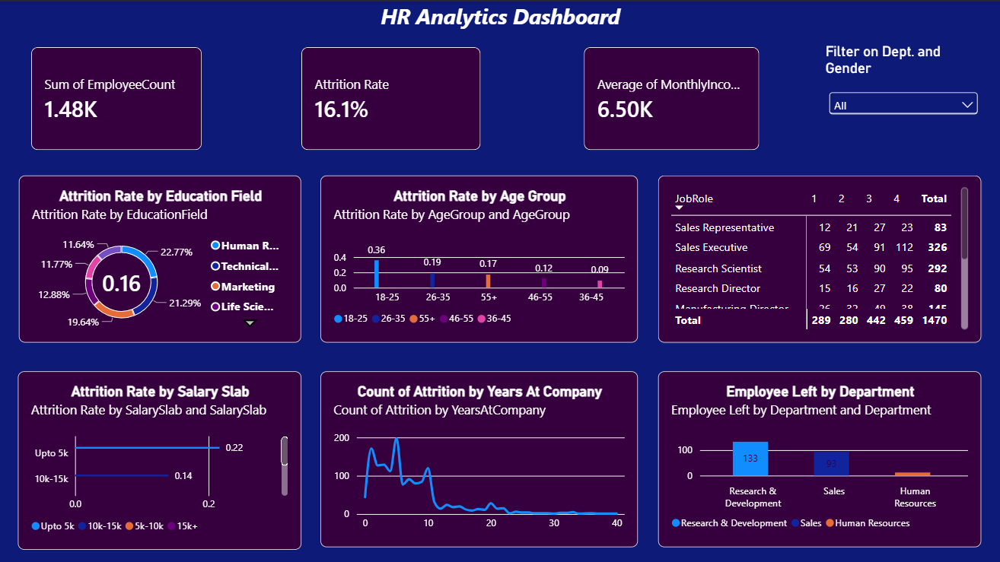

# HR Analytics Dashboard | Power BI

## 📌 Project Overview

The **HR Analytics Dashboard** is an interactive Power BI project designed to analyze employee attrition, workforce demographics, salary distribution, job roles, and department-level employee exits.

The dashboard transforms HR data into visual insights that can help HR teams understand workforce patterns, identify attrition trends, and support data-driven decision-making.

## 🎯 Business Objectives

- Analyze overall employee count and attrition rate.
- Understand attrition patterns across education fields, age groups, and salary slabs.
- Compare employee distribution across job roles.
- Examine employee exits across departments.
- Explore the relationship between employee tenure and attrition.
- Present HR metrics through an interactive dashboard.

## 🛠️ Tools & Technologies

- **Power BI Desktop** – Dashboard development and data visualization
- **Power Query** – Data preparation and transformation, if used
- **DAX** – KPI calculations and measures, if used
- **Data Visualization** – KPI cards, donut charts, bar charts, line charts, and tables

## 📊 Key Performance Indicators (KPIs)

The dashboard displays the following summary metrics:

| KPI | Description |
|---|---|
| Employee Count | Overall employee count displayed in the dashboard |
| Attrition Rate | Percentage of employees who left, based on the report's calculation |
| Average Monthly Income | Average monthly employee income |

## 📷 Dashboard Screenshots

### 1. Overall HR Analytics Dashboard



**Description:**

The main dashboard provides a consolidated view of workforce metrics and employee attrition patterns.

It includes:
- KPI cards for employee count, attrition rate, and average monthly income.
- Attrition analysis by education field, age group, and salary slab.
- A job-role summary table.
- Employee attrition analysis by years at the company.
- Department-level employee exits.
- A department and gender filter for interactive exploration.

### 2. Employee Attrition by Education Field


**Description:**

This visualization compares the attrition rate across different education fields, helping HR teams examine whether attrition patterns vary by employees' educational backgrounds.

### 3. Attrition by Age Group


**Description:**

This chart compares attrition rates across age groups to highlight differences in employee retention patterns across career stages.

### 4. Attrition by Salary Slab


**Description:**

This visualization compares attrition rates across salary ranges and helps explore whether employee exits vary by salary level.

### 5. Attrition by Years at Company


**Description:**

This chart examines employee attrition counts in relation to years at the company. It helps identify tenure ranges where employee exits appear more concentrated.

### 6. Employee Exits by Department


**Description:**

This chart compares the number of employees who left across departments, helping identify where further investigation into employee retention may be useful.

### 7. Job Role Analysis


**Description:**

The job-role table summarizes employee counts across job roles and provides a role-level view of workforce distribution.

> **Screenshot note:** The main dashboard screenshot is included above. The individual screenshot sections are optional; add the corresponding image files to the `screenshots` folder if you capture those close-ups. Otherwise, keep only the overall dashboard screenshot section.

## 🔍 Key Observations

Based on the current dashboard:

- The displayed employee count is approximately **1.48K**.
- The displayed attrition rate is **16.1%**.
- The displayed average monthly income is approximately **6.50K**.
- Attrition rates vary across the displayed education fields, age groups, and salary slabs.
- Department-level employee exits and job-role distribution provide areas for further HR analysis.

*Note: These are dashboard observations, not proof of the causes of employee attrition. Validate the KPI definitions and employee-count totals against the underlying dataset before using them in formal reporting.*

## 💡 Business Value

The dashboard demonstrates how HR data can be summarized into accessible metrics and visualizations. It can help stakeholders:

- Monitor workforce and attrition metrics.
- Identify employee groups that may require further investigation.
- Compare attrition patterns across departments and job roles.
- Support evidence-based employee retention discussions.

## 🚀 How to View the Project

1. Download `HR_Analytics_Dashboard.pbix` from this repository.
2. Open the file using Power BI Desktop.
3. Explore the KPI cards, charts, and job-role table.
4. Use the department and gender filter to interact with the report.

**Requirements:** Power BI Desktop. Data refresh may require access to the original dataset or data source.

## 📁 Repository Structure

```text
HR-Analytics-Dashboard/
│
├── HR_Analytics_Dashboard.pbix
├── README.md
└── screenshots/
    ├── HR_Dashboard.png
    ├── attrition_education.png
    ├── attrition_age_group.png
    ├── attrition_salary_slab.png
    ├── attrition_years_at_company.png
    ├── employee_exits_department.png
    └── job_role_analysis.png
```

## 📚 Skills Demonstrated

- HR Data Analytics
- Exploratory Data Analysis
- Data Visualization
- KPI Reporting
- Workforce and Attrition Analysis
- Dashboard Design
- Power BI

## 👨‍💻 Author

**Gourab Banerjee**

GitHub: [BanerjeeGourab](https://github.com/BanerjeeGourab)

---

⭐ If you find this project useful, feel free to explore the dashboard and its visualizations.
